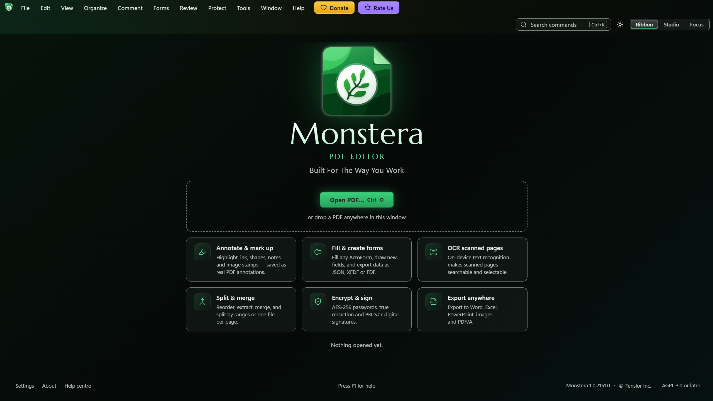
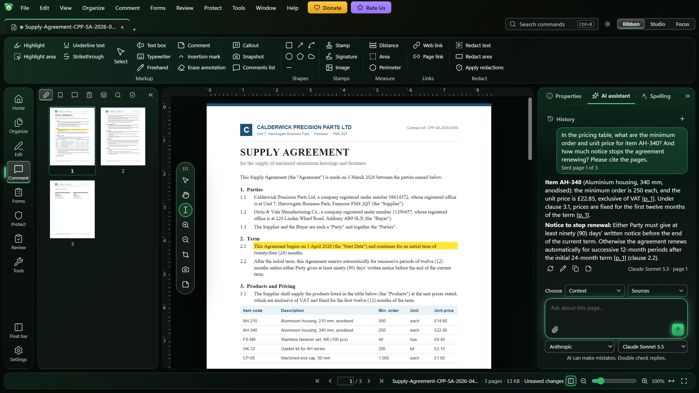
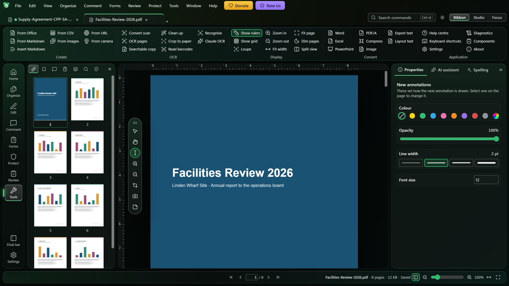
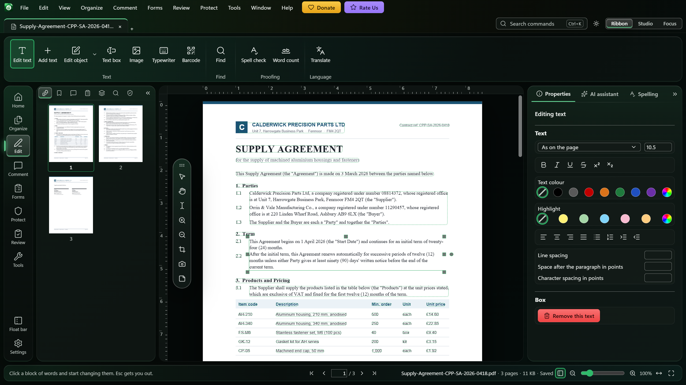
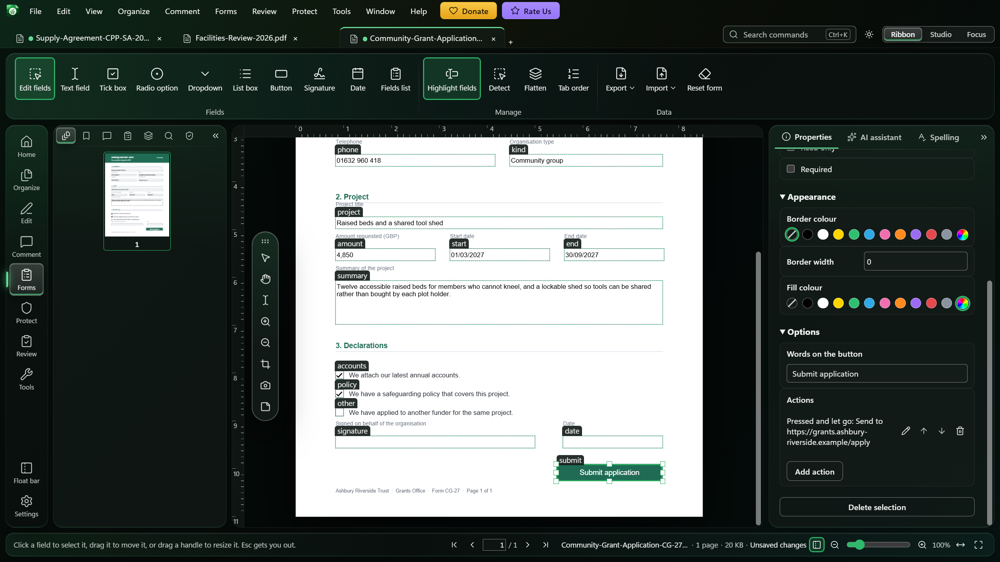
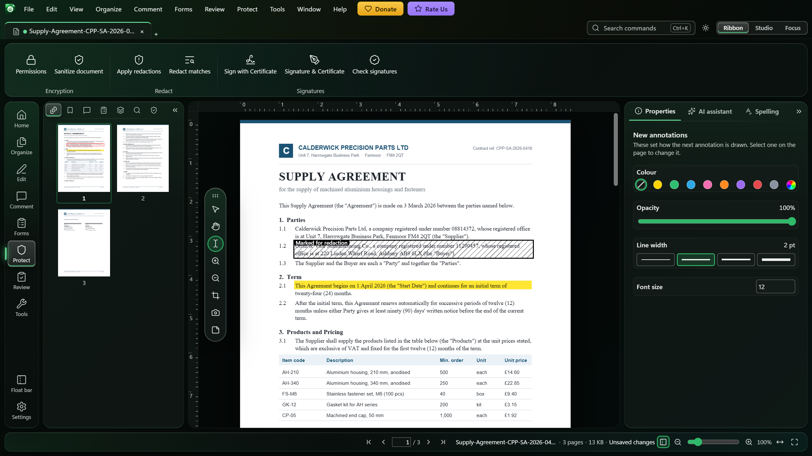
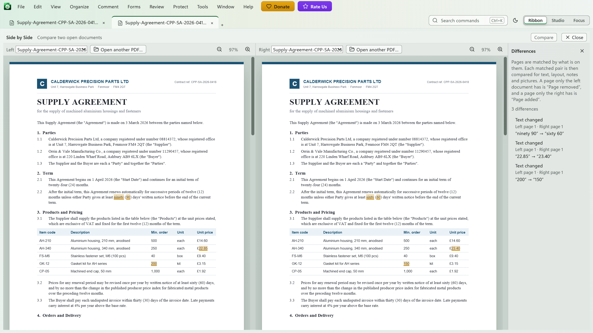
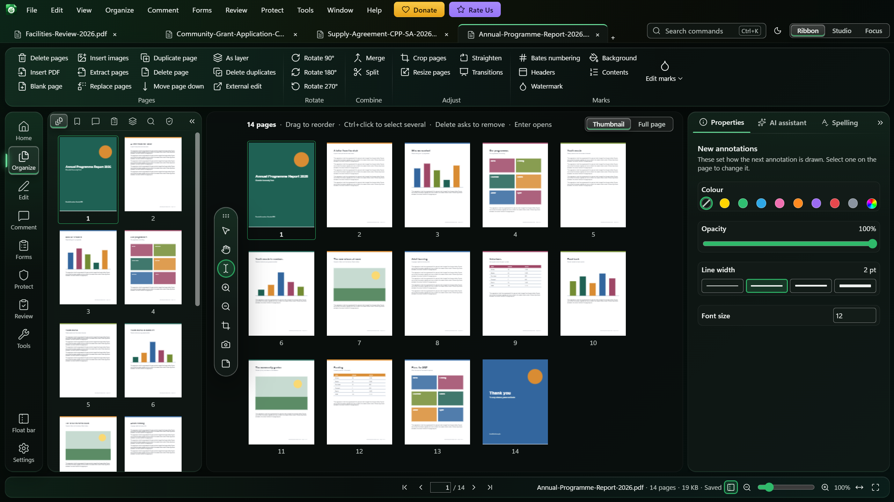
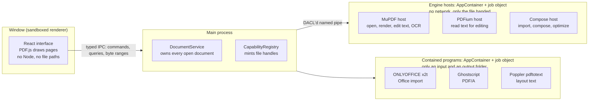
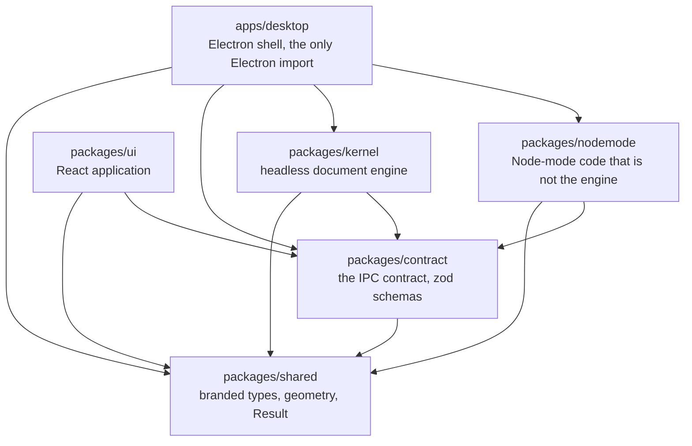

<div align="center">


# Monstera PDF Editor

**Built For The Way You Work**

A free, open-source, professional PDF editor for Windows 10 and 11

[](https://apps.microsoft.com/detail/9NHV3B1PV3XS)
[](https://github.com/tenslorai-tar/monstera/actions/workflows/ci.yml)
[](https://github.com/tenslorai-tar/monstera/actions/workflows/guards.yml)
[](LICENSE)
[](https://apps.microsoft.com/detail/9NHV3B1PV3XS)
[](https://github.com/tenslorai-tar/monstera/releases)

<a href="https://apps.microsoft.com/detail/9NHV3B1PV3XS"></a>

</div>

---

Monstera is a PDF editor for Windows that is free in full: no subscription, no
account and no watermark on anything you save. It brings more than 150 tools to
one calm desktop window, for viewing, organising pages, annotating, filling and
building forms, editing text in place, OCR, redaction, signing, comparing and
converting. Your documents stay on your PC, and every document is parsed inside
a Windows AppContainer sandbox that has no network and no access to files it was
not handed. An optional AI assistant answers questions about your document,
using your own key with any of ten providers.

<!-- demo video: added at launch -->

## Screenshots

<table>
  <tr>
    <td width="50%" valign="top">
      
      <br><sub>The start screen: open a PDF or drop one anywhere, the main tools one click away, and your recent files.</sub>
    </td>
    <td width="50%" valign="top">
      
      <br><sub>Monstera's AI assistant answers a question about a supply agreement with page citations, beside a highlighted clause and the page thumbnails.</sub>
    </td>
  </tr>
  <tr>
    <td width="50%" valign="top">
      
      <br><sub>The Tools ribbon shows every way to create, recognise, convert and view a document, here an eight-page facilities report.</sub>
    </td>
    <td width="50%" valign="top">
      
      <br><sub>Edit text opens a paragraph of a contract for editing, with its font, size, colour and spacing in the Properties panel.</sub>
    </td>
  </tr>
  <tr>
    <td width="50%" valign="top">
      
      <br><sub>The Forms tools show every field of a grant application, with the selected Submit button's options and its submit action in the Properties panel.</sub>
    </td>
    <td width="50%" valign="top">
      
      <br><sub>A redaction marked over a company's registration details, ready to apply from the Protect ribbon.</sub>
    </td>
  </tr>
  <tr>
    <td width="50%" valign="top">
      
      <br><sub>Compare places two drafts of an agreement side by side and marks each change, with a list of the differences.</sub>
    </td>
    <td width="50%" valign="top">
      
      <br><sub>The page organiser shows every page of a long document as a card, ready to rearrange, rotate, insert or delete.</sub>
    </td>
  </tr>
</table>

## What it is

A PDF editor that is genuinely professional and genuinely free. It is built to
professional standards: every feature is tested against real documents and must
survive save and reopen. It runs as a Windows desktop application with light and
dark themes, follows Windows' contrast themes, offers three layouts (Ribbon,
Studio and Focus), and carries its own help, which works offline: press F1.

It is distributed through the **Microsoft Store** only, and the Store keeps it up
to date. monsterapdf.com links to the Store listing.

The whole application is open source under the AGPL, and the codebase is written
to be read. See [Why the codebase looks the way it does](#why-the-codebase-looks-the-way-it-does).

## Feature surface

### Viewing and navigation
- Continuous, single page or facing pages, with fit width, fit page and zoom.
- Tabs for many documents, and a split view of one document.
- Thumbnails, bookmarks, links and layers panels.
- Find text, with match case, whole word and pattern options.
- A loupe, rulers and a grid, and dimmed pages for working in a dark room.
- Light, dark or system theme with an accent colour, and Ribbon, Studio or Focus layouts.
- Search every command with Ctrl+K, and reopen recent files.

### Page management
- Rotate, delete, duplicate and reorder pages, or swap two.
- The page organiser: every page as a card, to rearrange, rotate, insert or delete.
- Insert blank pages, pages from another PDF, or images as pages.
- Extract, split, merge and replace pages.
- Crop and resize pages, and straighten crooked scans.
- Headers and footers with page numbers, Bates numbering, watermarks and page backgrounds.
- A table of contents from the bookmarks, page transitions, and a search for duplicate pages.

### Annotations and markup
- Highlight, underline and strike through text, or highlight an area.
- Text boxes, typewriter text, notes, callouts and insertion marks.
- Freehand ink, rectangles, ellipses, lines, arrows, polygons, connected lines and clouds.
- Stamps, placed images and links.
- Measure distance, area and perimeter at a scale you set.
- Colour, opacity, line width, author and replies, saved as standard PDF annotations.
- Select, move, copy, paste and erase marks, and snapshot a region as an image.

### Text editing
- **Edit text** changes the words on the page in place, in paragraphs that reflow. Only the block you edit changes; everything else on the page is left exactly as it was, and a paragraph that grows may overlap the text below it rather than move it. It keeps the original font wherever that font can draw the letters, and sets any other letter in the closest font it can find, so an edit is never refused for its font.
- Add new text, with bold, italic, alignment, lists and spacing.
- Right-to-left text, and scanned pages that can be recognised and then edited.
- **Edit Object** moves, resizes, recolours, reorders or removes any text, image or shape on the page, rewriting only the object you changed.
- **Find and replace** across the whole document.
- Spell check, word count, and translating a page with the AI assistant.

### Forms
- Fill text fields, tick boxes, radio buttons, dropdowns, lists and signature fields, with a date picker for dates.
- Create eight kinds of field by drawing them, or let Monstera suggest the fields of a flat form.
- Field properties, formats, calculations, alignment and tab order.
- Button actions: go to a page, open a link, show or hide fields, print, import data, **Submit** (FDF, XFDF or web form data, to a web address or by email) and **Reset**.
- **Reset form**, flatten a form, and delete fields.
- Import and export form data as JSON, XFDF or FDF.
- A document's own scripts are never run; a field that would need one is marked as such.

### Scans, OCR and handwriting
- Detect scanned pages and make them searchable, offline, with Tesseract's bundled language models.
- An invisible, selectable text layer, and a searchable copy to export.
- Recognise the text in a box you draw.
- Read handwriting with Azure Document Intelligence or Claude, using your own key.
- Straighten, clean up and crop photographed pages to the edge of the paper.
- Convert a scan to a searchable PDF, Word or Excel, and read barcodes.

### Security and signatures
- Open protected PDFs, and set passwords and permissions with AES-256.
- True redaction, which removes the content rather than covering it, including find and redact.
- Sanitize: remove scripts, attached files and actions that send data.
- Sign with a .p12 or .pfx certificate, with optional certification and a timestamp.
- Visible signatures that are drawn, typed or uploaded, with or without a certificate.
- Check signatures: who signed, whether the certificate is valid, and whether the file changed since.
- Send a document for signing through DocuSign, with your own integration key.

### Review and compare
- Compare two documents, with every change marked on both and a list of the differences.
- View two documents side by side.
- A comments list by page, where a click jumps to the comment.
- Import and export comments as XFDF, FDF or JSON.
- A document accessibility check and a reading order inspector.
- A summary of the comments from the AI assistant.

### Import and create
- A new PDF from Word, Excel or PowerPoint files, in the current or the older formats.
- A new PDF from Markdown, or Markdown inserted into the open document.
- A PDF table from a CSV file.
- A new PDF from JPEG or PNG images, or from your webcam.
- Open a PDF from a web address.
- Open from and save back to OneDrive and Google Drive.
- Edit a page in another application and bring it back, or import a page as a layer.

### Export and convert
- Word, as flowing text, as an exact layout or as text only.
- PowerPoint, as exact pictures of the pages or as editable text.
- Excel, with a review grid for each table and styled cells.
- Pages as PNG, JPEG or WebP images at the resolution you choose.
- Plain text, or text that keeps the page layout.
- PDF/A (2b by default, or 1b or 3b), and a searchable copy.
- A smaller copy, printing, and email.

### AI assistant
- Chat about the page, the whole document, selected text or the comments.
- Ten providers: Anthropic, OpenAI, Gemini, Mistral, xAI, Azure OpenAI, OpenRouter, Groq, Perplexity and DeepSeek.
- Your own key, checked before it is saved and stored encrypted by Windows. Nothing is sent until you press Send.
- Answers cite pages, and a click goes to the page cited.
- Ask about a picture of the page, for tables and charts.
- Answer from the document only, or from the document and the web.
- Right-click selected text to ask about it, explain, summarise or translate it, or draft a reply.

### Built-in help
- Press F1 to open the Help centre at the tool you are using.
- 144 articles, built in and working offline.
- **Show me** points at the button for a tool.
- Search the help, and see every keyboard shortcut with Ctrl+/.

### Accessibility
- Built to WCAG 2.1 AA and checked by automated accessibility tests on every change.
- Every command can be reached from the keyboard, and every shortcut can be rebound.
- High contrast follows the Windows contrast theme.
- Check a document for screen reader problems and inspect its reading order.

## Privacy and security

### Things it will not do

- **No telemetry.** None. The application makes no network call on its own. The
  update check it is built with is dormant at launch: updates come only from the
  Microsoft Store, and Settings › Updates says so.
- **No silent cloud upload.** Document content reaches an AI provider, an online
  reading service or a cloud drive only when you ask, and the window you ask from
  names who receives it.
- **No automatic crash uploads.** A crash report is written on your computer and
  leaves it only if you choose to share it.
- **No plaintext secret storage.** API keys are kept encrypted with Windows' own
  protection, or the app says it cannot store them and refuses. There is no
  silent fallback.
- **Nothing in a document runs when you open it.** No embedded JavaScript, no
  automatic action, no external fetch and no embedded file written to disk, until
  you ask, for that item.

### How documents are handled

The window you see never holds a file path or the document's bytes. The main
process owns every open document; the window holds an opaque handle and asks for
the byte ranges it needs to draw a page. Parsing and editing happen in engine
hosts that Monstera creates as Windows AppContainer processes, each under a job
object, with no network and no file access beyond the file it was handed. The
converters Monstera runs as separate programs are contained the same way.



The full design, including each containment mechanism and how it was measured,
is in [`docs/ARCHITECTURE.md`](docs/ARCHITECTURE.md) §2, §3 and §8.

## Architecture



An arrow means *may import*. Anything else is a red build, enforced by ESLint
import rules and per-package TypeScript configurations, not by review.

A feature is finished when it is **registered**, not when it is wired: the
ribbon, menus, context menus, command palette, shortcuts and status bar are all
projections of one command registry, so there is no second place where a feature
is wired. The kernel never imports Electron or React, which makes the whole
document pipeline testable in milliseconds without a window. Every claim about
behaviour is backed by a proof with a control case that fails if the fix it
guards is removed.

## Tech stack

| Component | Version | Its job |
|---|---|---|
| [Electron](https://www.electronjs.org/) | 43.8.3 | The desktop shell; the same pinned binary runs the engine hosts in Node mode |
| [React](https://react.dev/) | 19.2.8 | The interface |
| [TypeScript](https://www.typescriptlang.org/) | 6.0.3 | Every package, in strict mode |
| [MuPDF](https://mupdf.com/) | 1.28.0 | The main PDF engine: opening, rendering, editing text in place, redaction, encryption; built from source into a native library loaded through [koffi](https://koffi.dev/) 3.1.5 |
| [PDFium](https://pdfium.googlesource.com/pdfium/) | 155.0.8044.0 | Reading a page's text, its runs and its fonts for Edit text, in its own contained host |
| [PDF.js](https://mozilla.github.io/pdf.js/) | 6.2.108 | Draws pages in the window; never the source of truth |
| [pdf-lib](https://github.com/cantoo-scribe/pdf-lib) (the `@cantoo/pdf-lib` fork) | 2.9.1 | Composing new documents, creating form fields and the OCR text layer |
| [Tesseract](https://github.com/tesseract-ocr/tesseract) (`tesseract.js-core`) | 7.0.0, with tessdata_fast 4.0.0 | OCR, offline, inside the MuPDF host |
| [Ghostscript](https://www.ghostscript.com/) | 10.08.0 | PDF/A export, as a contained program |
| [Poppler](https://poppler.freedesktop.org/) | 26.09.0 | Text export that keeps the layout (`pdftotext -layout`), as a contained program |
| [ONLYOFFICE](https://github.com/ONLYOFFICE/core) x2t | 9.4.0.130 | Word, Excel and PowerPoint import, as a contained program |
| [zxing-wasm](https://github.com/Sec-ant/zxing-wasm) | 3.1.4 | Reading and writing barcodes |
| [fflate](https://github.com/101arrowz/fflate) | 0.8.3 | The zip under every Word, PowerPoint and Excel export |
| [HarfBuzz](https://harfbuzz.github.io/) (`harfbuzzjs`) | 1.6.2 | Reading and subsetting fonts for Edit text |
| Bundled open fonts | from google/fonts | The fallback faces for Edit text when a document's own font cannot draw a letter: Arimo, Tinos, Cousine, Carlito, Caladea, Noto Sans Arabic, Noto Naskh Arabic and Noto Sans Symbols 2 |
| [GNU Unifont](https://unifoundry.com/unifont/) | 18.0.01 | The last fallback face, for any character of the Basic Multilingual Plane no other font can draw; provisioned from ftp.gnu.org, pinned by sha256, embedded as a subset |
| [Vite](https://vite.dev/) | 7.3.6 | Bundles the interface |
| [Vitest](https://vitest.dev/) and [Playwright](https://playwright.dev/) with axe-core | | Unit tests, rendered accessibility tests and visual tests |

Exact versions and hashes live in `package-lock.json` and the provisioning
scripts under [`scripts/provision/`](scripts/provision/). Every third-party
component's licence is in [`NOTICE`](NOTICE).

## Project structure

```
apps/desktop/       the Electron shell: windows, the composition root, engine host factory
packages/shared/    branded types, geometry, Result, pure utilities
packages/contract/  the IPC contract: every renderer-facing channel, defined once with zod
packages/kernel/    the headless document engine: commands, undo, save, OCR, export, engine hosts
packages/ui/        the React application, per-document stores, registries, help articles
packages/nodemode/  code that runs in Node mode and is not the document engine
packages/testing/   the fixture corpus, the proof harness, rendered and visual tests
native/             the C source we compile: the MuPDF shim, and security proof harnesses
scripts/            provisioning, build, release tooling, checks and git hooks
assets/             brand artwork, the bundled display font and textures
docs/               the architecture, decisions (ADRs), features, journal and threat model
```

### The files at the root

| File | What it is |
|---|---|
| [`BUILD-PROMPT.md`](BUILD-PROMPT.md) | The founding record of the project. Never edited after its first commit, with one exception by the owner's decision of 2026-10-25: two lines that named another product were reworded. |
| [`CLAUDE.md`](CLAUDE.md) and [`AGENTS.md`](AGENTS.md) | The operating rules every contributor and coding agent follows. Monstera is built with AI coding agents working under these rules. |
| [`.claude/`](.claude/) | The agents' settings and the guard hooks that stop unsafe commands before they run. |
| [`DESIGN-DRAFT.html`](DESIGN-DRAFT.html) | The original design reference the design tokens were drawn from. |
| [`TRADEMARKS.md`](TRADEMARKS.md) | What you may do with the name and logos. |
| [`CONTRIBUTOR-AGREEMENT.md`](CONTRIBUTOR-AGREEMENT.md) | The agreement under which code contributions are accepted. |
| [`NOTICE`](NOTICE) | Every third-party component's licence and source offer, generated from the lockfile and the native components. |
| [`SECURITY.md`](SECURITY.md) | How to report a vulnerability privately. |

These files are referenced by the founding record and by the tooling, so they
stay where they are.

## Why the codebase looks the way it does

**The codebase is the product as much as the app is.** It is written to be read.

Two documents govern it:

- **[`BUILD-PROMPT.md`](BUILD-PROMPT.md)**: the founding record. Never edited
  after its first commit, but for one rewording by the owner's decision of
  2026-10-25 (two lines that named another product).
- **[`docs/ARCHITECTURE.md`](docs/ARCHITECTURE.md)**: the living law. Changed
  only through a recorded amendment, with the rejected alternatives written
  down.

The rule underneath both:

> When you hit a problem, do not quickly find a workaround. Investigate the root
> cause and fix it from the root. Your first intuition must not be a workaround;
> it must be investigation.

Every workaround in a public codebase is a permanent, signed statement that
nobody understood the problem. So the standard here is that you can state the
actual mechanism in one sentence before you change a line, and every fix ships a
proof with a control case, meaning the proof fails if the fix is removed.

## Building from source

Requires **Windows**, Node.js 22.19 or newer, Git, and Visual Studio's C++
build tools (for the MuPDF library). The application runs on Windows only,
because documents are parsed in engine hosts that are Windows AppContainer
processes.

```bash
git clone https://github.com/tenslorai-tar/monstera.git
cd monstera
npm install
```

`npm install` also enables this repository's git hooks, which scan for secrets
and reject binaries and oversized files before they can enter the permanent
public history. If a commit is rejected because the scanner is not installed,
run `node scripts/provision/gitleaks.mjs`. **Do not bypass the hook.**

To run it, fetch the pinned Electron runtime, build the MuPDF library the
engine hosts load, let the contained hosts run the runtime, build, and start:

```bash
npm run provision:electron
npm run provision:mupdf
npm run provision:grants
npm run build
npm start
```

Further features need a further tool, each fetched and checked against a pinned
SHA-256 by its own command: `provision:pdfium` (editing text in place),
`provision:tessdata` (OCR), `provision:onlyoffice` (Office import),
`provision:poppler` (text export with layout), `provision:ghostscript` (PDF/A),
`provision:fonts` (the bundled fallback fonts) and `provision:vcruntime` (the
Visual C++ runtime the shipped programs load). The app starts without them, and
a feature whose tool is absent says so by name.

`provision:electron` downloads the pinned build and verifies it against a
recorded SHA-256; it is a separate step because importing the `electron`
package is itself a download, through an installer that can be repointed away
from the pin. `npm run build` is a typecheck **plus** both bundles, and
`npm start` refuses to launch a build older than the source it was made from,
because otherwise the window shows the previous version of the app and looks
identical.

## Contributing

Bug reports are the most helpful thing you can send.
[Open an issue](https://github.com/tenslorai-tar/monstera/issues/new/choose) and
say what you did, what you expected and what happened. **Never attach a PDF with
personal or confidential content**: use a harmless sample, or redact it first.

Code is welcome too. [`CONTRIBUTING.md`](CONTRIBUTING.md) explains how, and
[`CONTRIBUTOR-AGREEMENT.md`](CONTRIBUTOR-AGREEMENT.md) sets out the terms: code
contributions are assigned to Tenslor Inc., and you are credited for them. Everyone
taking part agrees to the [Code of Conduct](CODE_OF_CONDUCT.md).

## Security

Please report vulnerabilities privately, through the Security tab's
**[Report a vulnerability](https://github.com/tenslorai-tar/monstera/security/advisories/new)**,
or by email to report@monsterapdf.com. See [`SECURITY.md`](SECURITY.md).

## Support

- **Help:** press F1 in the app, or read the help online at https://monsterapdf.com/help.
- **Questions and ideas:** [GitHub Discussions](https://github.com/tenslorai-tar/monstera/discussions).
- **Email:** support@monsterapdf.com for help, report@monsterapdf.com for reports.

## Licence and trademarks

**[AGPL-3.0-or-later](LICENSE).**

Monstera PDF Editor is built on **MuPDF**, which we build from MuPDF's source and
**statically link** into a native library the engine hosts load. That is a
combined work by any reading, and MuPDF is AGPL, so Monstera PDF Editor is AGPL.
In plain terms: you may use, study, modify and redistribute this software, and if
you distribute it, or run a modified version as a network service, you must offer
the corresponding source under the same licence.

### The source offer

Because the linkage is static rather than a bundled upstream binary, the offer
covers more than this repository. It is everything you would need to rebuild what
actually ships, at the exact versions shipped:

- **MuPDF 1.28.0** itself: the hash-verified upstream tarball, listed in
  [`scripts/provision/mupdf.mjs`](scripts/provision/mupdf.mjs);
- **the build configuration** used to produce the static libraries, which is what
  makes the result reproducible rather than merely available;
- **the source of the C shim** that links it,
  [`native/mupdf-shim/`](native/mupdf-shim/), and the generator
  [`scripts/provision/mupdfGlue.mjs`](scripts/provision/mupdfGlue.mjs), which
  turns MuPDF's own flat-C binding (`platform/wasm/lib/mupdf.c` in MuPDF's tree)
  into the C the shim compiles;
- **the separately AGPL-licensed components inside MuPDF's own tree**:
  `extract` and `jbig2dec`, both AGPL-3.0-or-later. These arrive within MuPDF, so
  "the MuPDF version" arguably covers them already. Naming them costs a line and
  removes the argument.

ONLYOFFICE's x2t (AGPL), Ghostscript (AGPL) and Poppler (GPL) run as separate
programs, never linked; their written source offers are in [`NOTICE`](NOTICE),
with every other third-party component's terms.

[`NOTICE`](NOTICE) is generated from
[`scripts/release/nativeComponents.json`](scripts/release/nativeComponents.json)
and the lockfile. This list is a summary written by hand; if the two ever differ,
`NOTICE` is right.

**To request it:** [open an issue](https://github.com/tenslorai-tar/monstera/issues)
in this repository. We will send a copy for at least three years after the last
distribution of the corresponding binary.

### Third-party notices

[`NOTICE`](NOTICE) is generated, not hand-maintained: from the lockfile's
production tree, and from the libraries the shim actually compiles. Every bundled
licence names the file its terms were read from, inside MuPDF's source tree, so
each claim can be checked in one command rather than taken on trust. One is worth
calling out because it looks wrong and is not: **MuJS 1.3.8 is ISC here**, read
from `thirdparty/mujs/COPYING`, although Artifex positions MuJS publicly as
AGPL-or-commercial. The grant in the tree we build from is what governs.

Two components carry conditions beyond attribution, and both are discharged in
`NOTICE`: **FreeType** is dual-licensed and we take the FreeType License, whose
binary-distribution clause requires a disclaimer that this software is based in
part on the work of the FreeType Team; and **zint** is BSD only for its backend,
which is the only part compiled here.

### Trademarks

The **name and the brand assets** in [`assets/brand/`](assets/brand/) are owned
by Tenslor Inc. and are not covered by the code licence. A fork must use its
own, so users can tell whose build they are running. What you may do with them
without asking is in [`TRADEMARKS.md`](TRADEMARKS.md).

---

<div align="center">
<sub>© 2026 Tenslor Inc.</sub>
</div>
